<p align="center">
  
</p>

<h1 align="center">PlayCurfew</h1>

<p align="center">
  
  <a href="README.vi.md"></a>
</p>

<p align="center">
  A Windows app that helps you control your own gaming time.<br />
  It counts your minutes each day and closes games when time runs out or during study hours.
</p>

<p align="center">
  <a href="https://github.com/anphuctran2005/playcurfew/releases/latest/download/PlayCurfew-Setup.exe"></a>
</p>

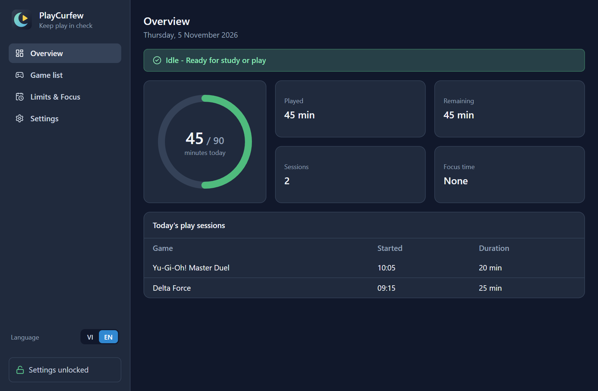

## Features

- **Daily play limits:** set separate limits for weekdays (Monday to Friday) and weekends (Saturday and Sunday).
- **Focus schedules:** listed games are closed if opened during study hours, including schedules that run past midnight.
- **Automatic tracking:** scans Windows processes every 5 seconds, counts play time, and closes games that break the rules.
- **Warnings:** notifies you when 5 minutes and 1 minute of play time remain.
- **Settings lock:** while you are playing, during Focus hours, or after your time runs out, actions that loosen the rules are disabled.
- **Emergency unlock:** you must retype a commitment sentence by hand, with no pasting, to unlock for 5 minutes.
- **History:** see today's play sessions with start times and durations.
- **Background mode:** closing the window only minimizes the app to the system tray, and tracking continues. The Quit option is disabled while settings are locked.
- **Start with Windows:** runs in the system tray when you sign in.
- **Two languages:** switch between English and Vietnamese at any time, including tray menus and notifications.
- **Custom background:** choose a light or dark theme, any background color, or your own image.

## Requirements

- Windows 10 or Windows 11 (64-bit)
- An account with Administrator rights
- Node.js 20.19+ or 22.12+ (tested with Node 24) and npm, only when installing from source

## Installation

### Using the installer

1. Click **Download for Windows** at the top of this page.
2. Run the downloaded `PlayCurfew-Setup.exe`, choose an install folder, then click **Install**. The installer creates a Desktop shortcut and opens the app when it finishes.

PlayCurfew needs Administrator rights to close games protected by anti-cheat software, so Windows asks for confirmation (UAC) each time you open the app yourself. With **Start with Windows** turned on, the app starts at sign-in without asking.

The installer is not code-signed, so Windows may show a SmartScreen warning. Click **More info**, then **Run anyway** to continue.

### From source

Install the dependencies:

```bash
npm install
```

npm may report a blocked install script for `better-sqlite3`. You can ignore this warning.

Run in development mode:

```bash
npm run dev
```

Build the Windows installer:

```bash
npm run build:win
```

The installer is written to `dist/PlayCurfew-Setup.exe`.

## How to use

The screenshots below were taken from the real app with sample data.

### Step 1: Add the games to control

Open the **Game list** tab. There are two ways to add a game:

- **Manually:** enter a display name and the file name, such as `masterduel.exe`, then click **Add**.
- **Scan open apps:** open the game first, click **Scan open apps**, pick the game's window from the list, edit the display name if needed, then click **Add**.

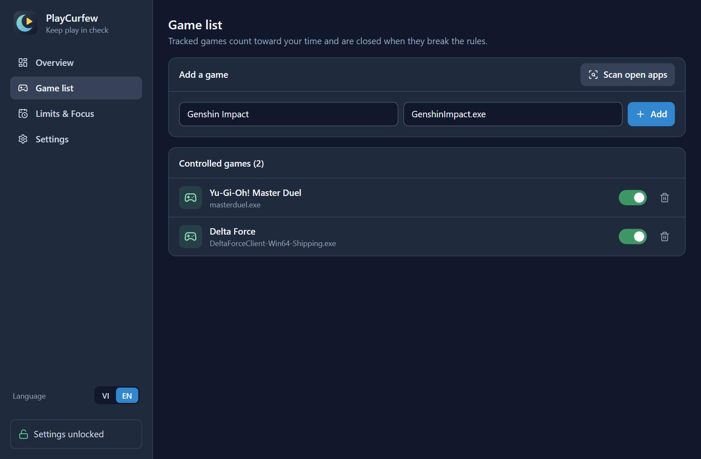

Use the switch to turn tracking on or off for each game.

> **Warning:** apps in this list are force-closed when they break the rules, and unsaved data is lost. Only add games. Do not add browsers, editors, or `explorer.exe`.

### Step 2: Set limits and Focus schedules

Open the **Limits & Focus** tab.

- **Daily limits:** drag the slider or enter the minutes, then click **Save settings**.
- **Focus schedules:** enter a label, a start and end time in 24-hour format (such as `19:30`), choose the days of the week, then click **Add schedule**. An end time earlier than the start time means the schedule ends the next day.

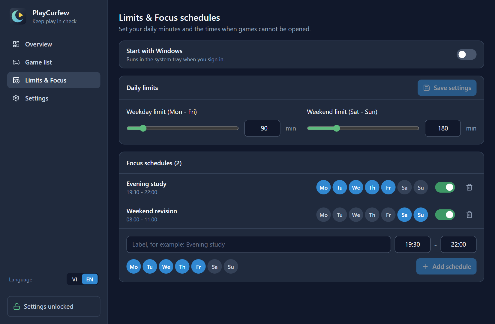

Existing schedules can be turned on or off, have days added or removed, and be deleted. To change the times, delete the schedule and create a new one.

### Step 3: Follow your day on the dashboard

The ring on the **Overview** tab shows minutes played against today's limit:

| Color | Meaning |
| --- | --- |
| Green | Less than 70% of the limit used |
| Yellow | 70% or more used, or less than 15 minutes left |
| Red | Out of time, or during Focus hours |

When you open a listed game, the status bar turns yellow and play time starts counting:

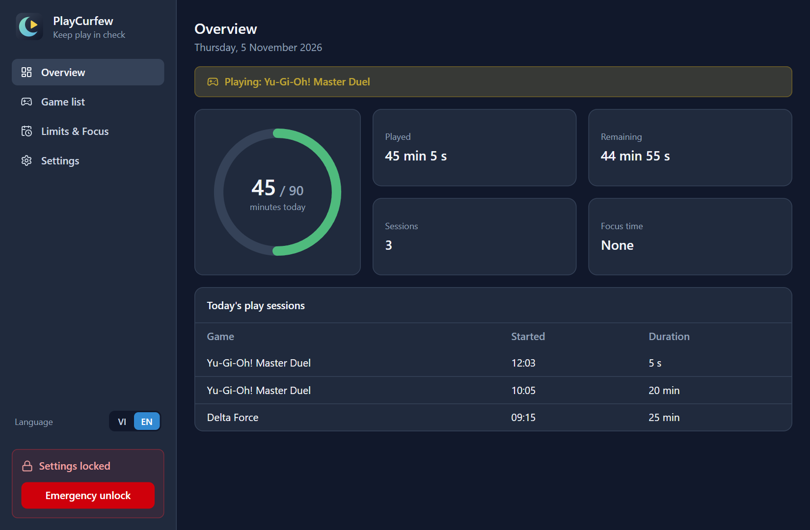

During Focus hours, the status bar and ring turn red, and open games are closed:

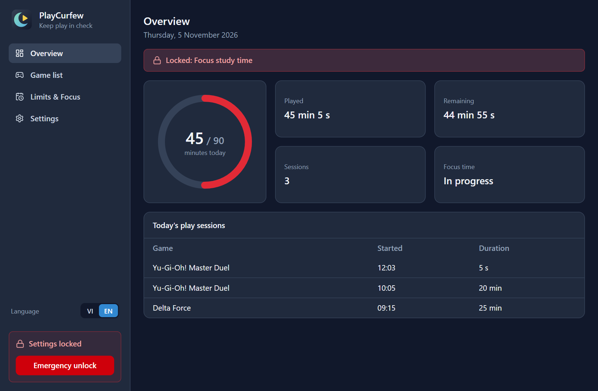

### Background mode and the system tray

Closing the window only minimizes the app to the system tray, next to the clock. Click the icon to open it again, or right-click to see the minutes left or quit the app.

Turn on **Start with Windows** at the top of the **Limits & Focus** tab to run the app in the background each time you sign in. This creates a `PlayCurfewAutoStart` task in Task Scheduler.

### Language and appearance

Use the **VI / EN** switch in the sidebar to change the language at any time. Tray menus, notifications, and the commitment sentence change with it.

Open the **Settings** tab to customize the app:

- **Theme:** choose **Dark** or **Light**.
- **Background color:** pick a preset or click **Choose another color** to use any color. **Default** returns to the theme's color.
- **Background image:** click **Choose image** and select a PNG, JPG, or WebP file up to 10 MB. The image takes priority over the color.

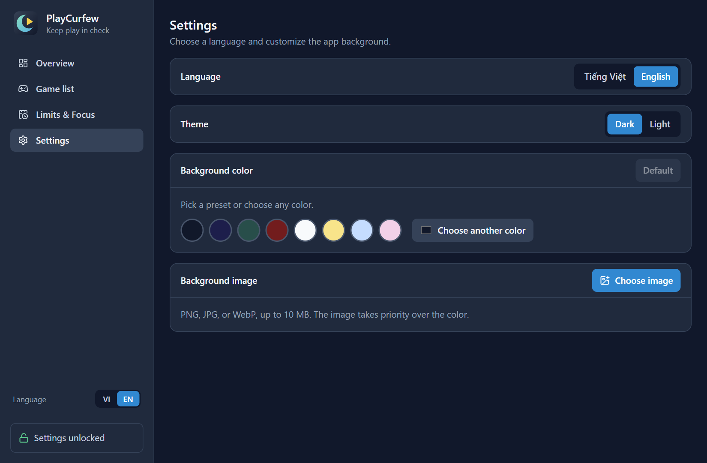

| Light theme | Background image |
| --- | --- |
| 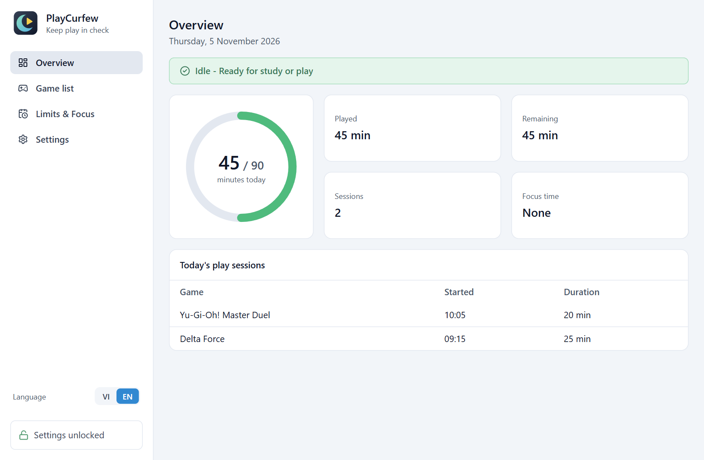 | 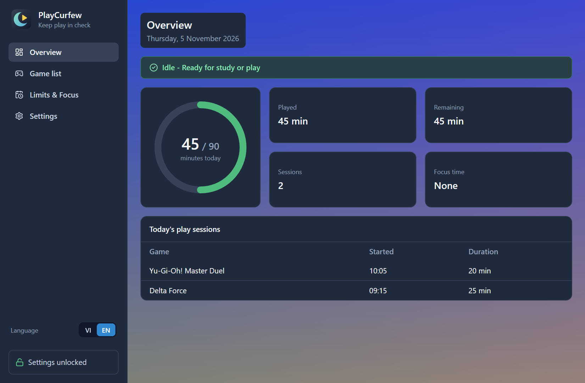 |

These settings are never locked.

### How the lock works

Settings lock automatically in any of three cases: during Focus hours, when today's play time has run out, or while a tracked game is running. Locked actions show a padlock icon.

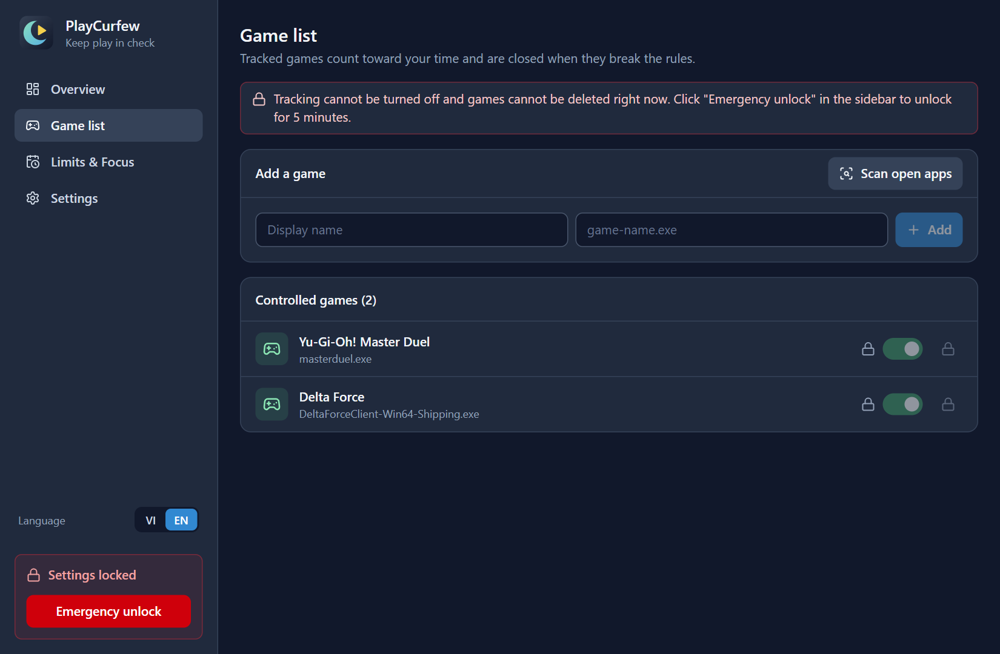

| Action | While locked |
| --- | --- |
| Add a game, turn tracking on | Allowed |
| Turn tracking off, delete a game | Locked |
| Lower the minute limit | Allowed |
| Raise the minute limit | Locked |
| Add a Focus schedule, add a day, turn a schedule on | Allowed |
| Turn off or delete a Focus schedule, remove a day | Locked |
| Turn Start with Windows on or off | Locked |
| Quit from the system tray | Locked |

### Emergency unlock

1. Click **Emergency unlock** in the sidebar. This button only appears while locked.
2. Retype the commitment sentence exactly, including punctuation and capitalization. Pasting is blocked. Correct characters turn green, and wrong ones get a red background.
3. Once the sentence matches completely, the **Confirm unlock (5 minutes)** button lights up. Click it.

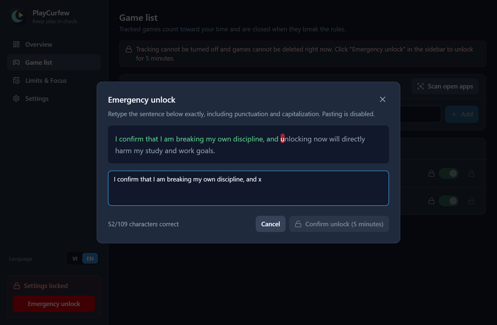

The sidebar shows a countdown, and settings lock again after 5 minutes. Unlocking only lets you change settings and quit the app: games are still closed during Focus hours or once your time runs out.

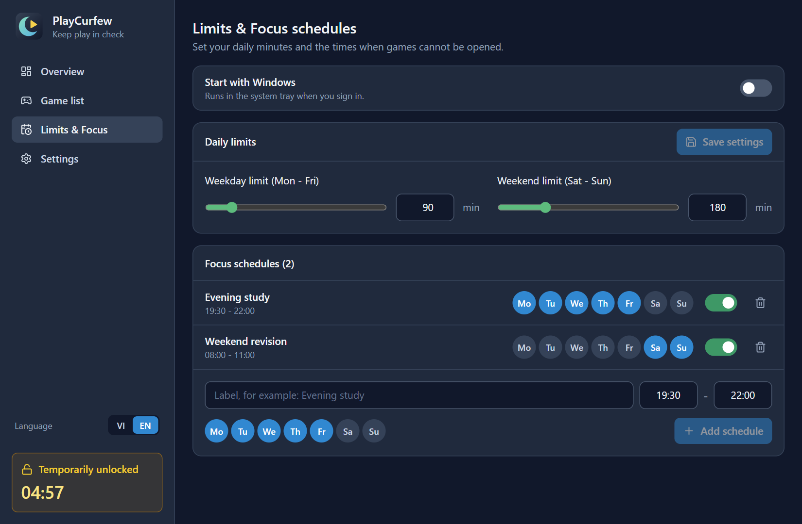

## Your data

All data stays on your computer at `%APPDATA%\playcurfew\config.json` and is never sent anywhere. Play time resets automatically each day.

## Current limitations

- **Task Manager can still end the app.** The Quit lock only covers quitting from within the app. Ending the process in Task Manager stops tracking.
- **Editing the config is not blocked.** Editing `config.json` directly still changes settings. PlayCurfew is a discipline aid, not a tamper-proof control.
- **Uninstalling:** the `PlayCurfewAutoStart` task is not removed automatically. Turn off **Start with Windows** before uninstalling.

## For developers

| Command | Purpose |
| --- | --- |
| `npm run dev` | Run the app with HMR |
| `npm run typecheck` | Check TypeScript |
| `npm run lint` | Run ESLint |
| `npm run icons` | Regenerate the icons from `src/renderer/src/assets/logo.svg` |
| `npm run build` | Typecheck, then bundle into `out/` |
| `npm run build:unpack` | Package without an installer into `dist/win-unpacked/` |
| `npm run build:win` | Build the Windows installer |

The source has three layers in `src/`, plus shared types:

| Folder | Role |
| --- | --- |
| `src/main/` | Process scanning, time tracking, closing games, storage, IPC |
| `src/preload/` | The `window.api` bridge between main and renderer |
| `src/renderer/` | React interface with Tailwind CSS |
| `src/shared/` | Shared data types |

The data specification is in [SPEC.md](SPEC.md), and the development conventions are in [CLAUDE.md](CLAUDE.md).
