<p align="center">
  
</p>

<h1 align="center">PlayCurfew</h1>

<p align="center">
  <a href="README.md"></a>
  
</p>

<p align="center">
  Ứng dụng Windows giúp bạn tự kiểm soát thời gian chơi game.<br />
  Đếm số phút chơi mỗi ngày, tự tắt game khi hết giờ hoặc khi đang trong giờ học.
</p>

<p align="center">
  <a href="https://github.com/anphuctran2005/playcurfew/releases/latest/download/PlayCurfew-Setup.exe"></a>
</p>

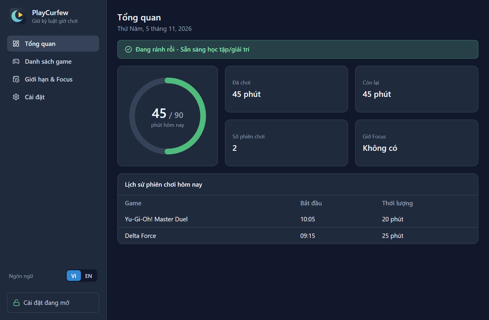

## Tính năng

- **Giới hạn giờ chơi mỗi ngày:** đặt riêng cho ngày thường (Thứ 2 - Thứ 6) và cuối tuần (Thứ 7 - CN).
- **Khung giờ Focus:** game trong danh sách sẽ bị tắt nếu mở trong giờ học, kể cả khung giờ vắt qua nửa đêm.
- **Chọn ứng dụng trực quan:** thêm game bằng cách bấm chọn, có icon thật, không cần gõ tên `.exe`.
- **Theo dõi tự động:** cứ 5 giây quét tiến trình Windows một lần, cộng giờ chơi và tắt game khi vi phạm.
- **Cảnh báo trong game:** khi còn 5 phút, 1 phút và 15 giây, một thanh cảnh báo kèm âm thanh hiện đè lên game, không chiếm focus và cho chuột bấm xuyên qua. Hoạt động ở chế độ cửa sổ và borderless. Dùng nút test trong **Giới hạn & Focus** để thử âm lượng.
- **Khóa cài đặt:** khi đang chơi, đang trong giờ Focus hoặc đã hết giờ, các thao tác nới lỏng quy tắc bị vô hiệu hóa.
- **Mở khóa khẩn cấp:** phải tự gõ lại một câu cam kết, không dán được, để mở khóa trong 5 phút.
- **Lịch sử:** xem các phiên chơi trong ngày với giờ bắt đầu và thời lượng.
- **Chạy ngầm:** đóng cửa sổ chỉ thu xuống khay hệ thống, ứng dụng vẫn theo dõi. Nút Thoát bị khóa khi đang khóa cài đặt.
- **Khởi động cùng Windows:** tự chạy ngầm dưới khay hệ thống khi bật máy.
- **Hai ngôn ngữ:** chuyển giữa tiếng Việt và tiếng Anh bất cứ lúc nào, gồm cả menu khay và thông báo.
- **Tùy biến nền:** chọn nền sáng hoặc tối, màu nền bất kỳ, hoặc ảnh của riêng bạn.

## Yêu cầu

- Windows 10 hoặc Windows 11 (64-bit)
- Tài khoản có quyền Administrator
- Node.js 20.19+ hoặc 22.12+ (đã kiểm thử với Node 24) và npm, chỉ cần khi cài từ mã nguồn

## Cài đặt

### Dùng bộ cài

1. Bấm nút **Tải về cho Windows** ở đầu trang.
2. Chạy file `PlayCurfew-Setup.exe` vừa tải, chọn thư mục cài đặt rồi bấm **Install**. Bộ cài tạo lối tắt trên Desktop và mở ứng dụng khi xong.

PlayCurfew cần quyền Administrator để tắt được game có Anti-Cheat, nên Windows sẽ hỏi xác nhận (UAC) mỗi lần bạn tự mở ứng dụng. Khi bật **Khởi động cùng Windows**, ứng dụng tự chạy lúc đăng nhập mà không hỏi lại.

Bộ cài chưa được ký số nên Windows có thể hiện cảnh báo SmartScreen. Bấm **More info** rồi **Run anyway** để tiếp tục.

### Cài từ mã nguồn

Tải dependency:

```bash
npm install
```

npm có thể báo chặn install script của `better-sqlite3`. Có thể bỏ qua cảnh báo này.

Chạy ở chế độ phát triển:

```bash
npm run dev
```

Tạo bộ cài cho Windows:

```bash
npm run build:win
```

Bộ cài nằm tại `dist/PlayCurfew-Setup.exe`.

## Hướng dẫn sử dụng

Ảnh dưới đây được chụp từ ứng dụng thật với dữ liệu mẫu.

### Bước 1: Thêm game cần kiểm soát

Mở tab **Danh sách game** rồi bấm **Thêm Game / Ứng dụng**. Có ba cách thêm:

- **Từ ứng dụng đang mở:** bảng chọn hiện các ứng dụng đang mở cùng icon thật. Hãy mở game trước, tìm theo tên hoặc tên `.exe` nếu cần, tick một hoặc nhiều ứng dụng rồi bấm **Thêm các ứng dụng đã chọn**. Ứng dụng đã có trong danh sách sẽ hiện **Đã thêm**.
- **Từ máy tính:** bấm **Chọn từ máy tính (File .exe hoặc Shortcut Desktop)** rồi chọn file `.exe` hoặc shortcut `.lnk`. Ứng dụng được thêm ngay.
- **Nhập tay:** mở mục **Tự nhập tên thủ công (Nâng cao)**, điền tên hiển thị và tên file, ví dụ `masterduel.exe`, rồi bấm **Thêm**.

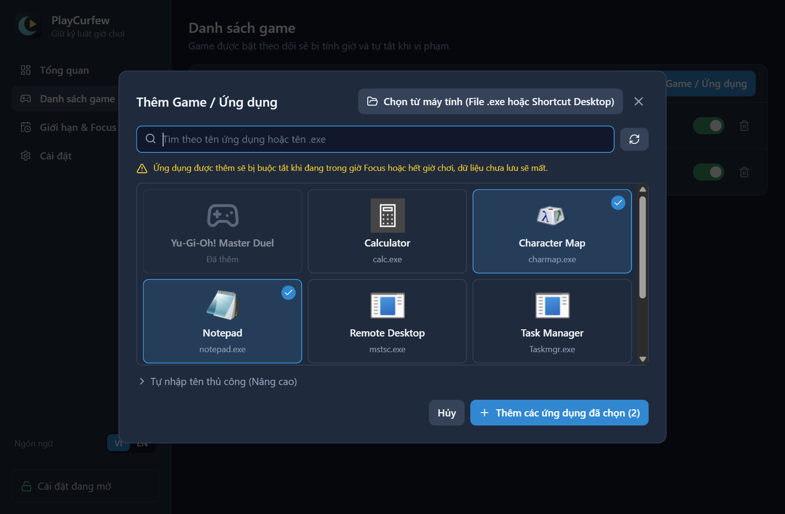

Dùng công tắc để bật hoặc tắt theo dõi từng game.

Shortcut Internet (`.url`), như loại một số trình quản lý game tạo ra, không đọc được. Với các game này, hãy chọn từ ứng dụng đang mở hoặc chọn file `.exe` của game.

> **Cẩn thận:** ứng dụng trong danh sách sẽ bị buộc tắt khi vi phạm, dữ liệu chưa lưu sẽ mất. Chỉ thêm game, không thêm trình duyệt, trình soạn thảo hay `explorer.exe`.

### Bước 2: Đặt giới hạn và khung giờ Focus

Mở tab **Giới hạn & Focus**.

- **Giới hạn mỗi ngày:** kéo thanh trượt hoặc nhập số phút, rồi bấm **Lưu cấu hình**.
- **Khung giờ Focus:** nhập nhãn, giờ bắt đầu và kết thúc theo dạng 24 giờ (ví dụ `19:30`), chọn các ngày trong tuần rồi bấm **Thêm khung giờ**. Giờ kết thúc nhỏ hơn giờ bắt đầu nghĩa là kết thúc vào hôm sau.

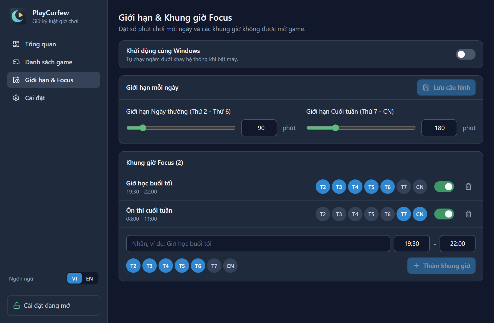

Khung giờ đã tạo có thể bật, tắt, thêm hoặc bớt ngày, và xóa. Để đổi giờ, hãy xóa rồi tạo khung giờ mới.

### Bước 3: Theo dõi ở màn hình Tổng quan

Vòng tròn cho biết số phút đã chơi trên giới hạn hôm nay:

| Màu | Ý nghĩa |
| --- | --- |
| Xanh lá | Đã dùng dưới 70% giới hạn |
| Vàng | Đã dùng từ 70% trở lên, hoặc còn dưới 15 phút |
| Đỏ | Đã hết giờ, hoặc đang trong giờ Focus |

Khi bạn mở một game trong danh sách, thanh trạng thái chuyển sang màu vàng và thời gian bắt đầu được tính:

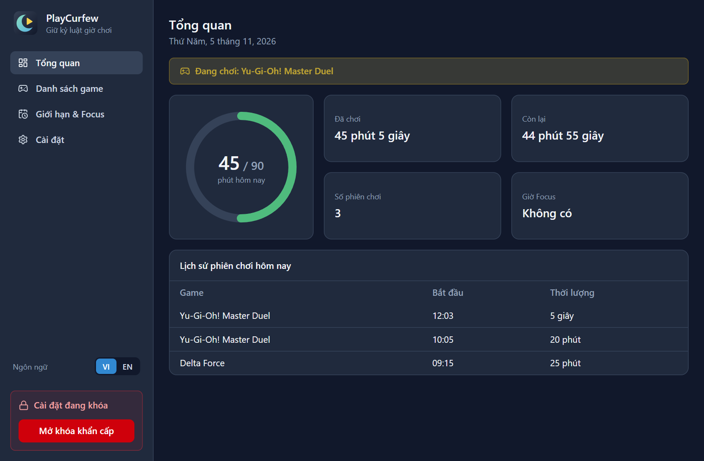

Trong giờ Focus, thanh trạng thái và vòng tròn chuyển sang màu đỏ, game đang mở sẽ bị tắt:

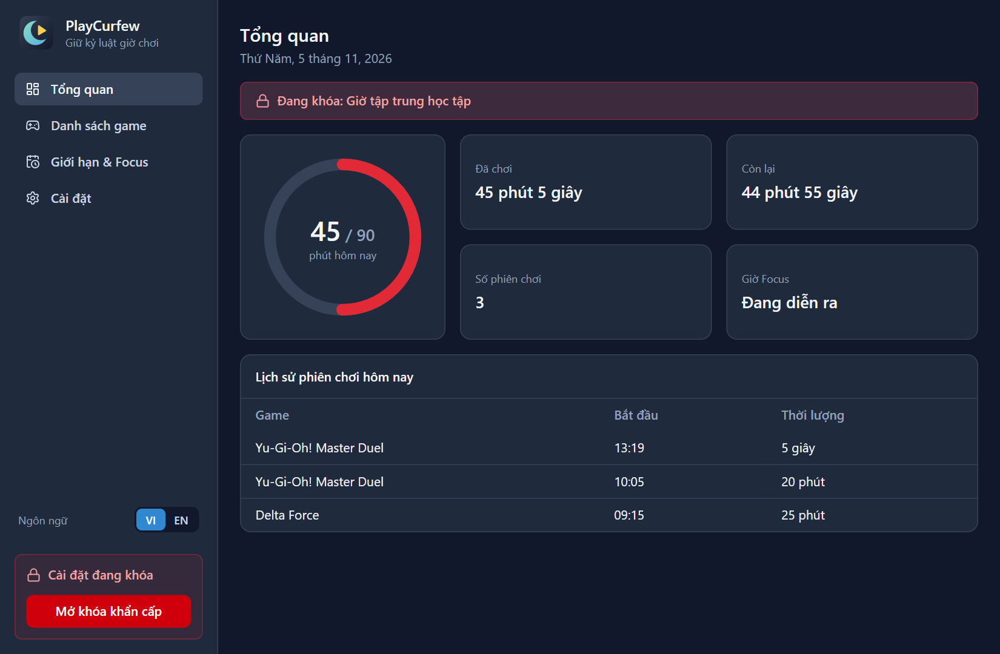

### Chạy ngầm và khay hệ thống

Bấm nút đóng cửa sổ chỉ thu ứng dụng xuống khay hệ thống, cạnh đồng hồ. Bấm vào biểu tượng để mở lại, bấm chuột phải để xem số phút còn lại hoặc thoát ứng dụng.

Bật **Khởi động cùng Windows** ở đầu tab **Giới hạn & Focus** để ứng dụng tự chạy ngầm mỗi khi đăng nhập. Tùy chọn này tạo tác vụ `PlayCurfewAutoStart` trong Task Scheduler.

### Ngôn ngữ và giao diện

Dùng nút **VI / EN** ở thanh bên để đổi ngôn ngữ bất cứ lúc nào. Menu khay, thông báo và câu cam kết sẽ đổi theo.

Mở tab **Cài đặt** để tùy biến ứng dụng:

- **Giao diện:** chọn **Tối** hoặc **Sáng**.
- **Màu nền:** chọn màu có sẵn hoặc bấm **Chọn màu khác** để dùng màu bất kỳ. **Mặc định** trả về màu của giao diện.
- **Ảnh nền:** bấm **Chọn ảnh** rồi chọn file PNG, JPG hoặc WebP tối đa 10 MB. Ảnh nền được ưu tiên hơn màu nền.

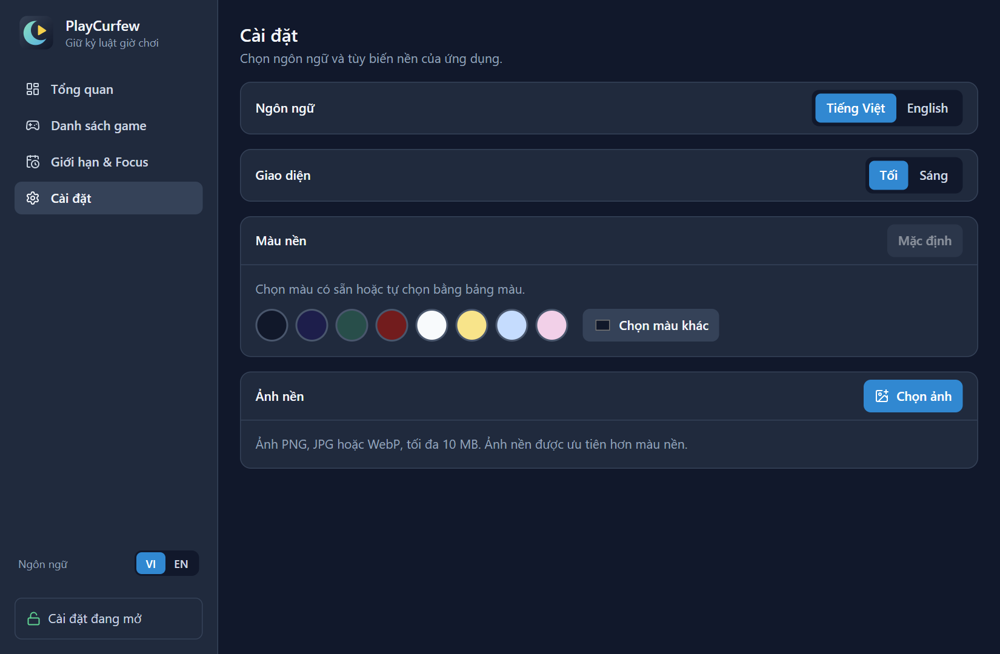

| Nền sáng | Ảnh nền |
| --- | --- |
| 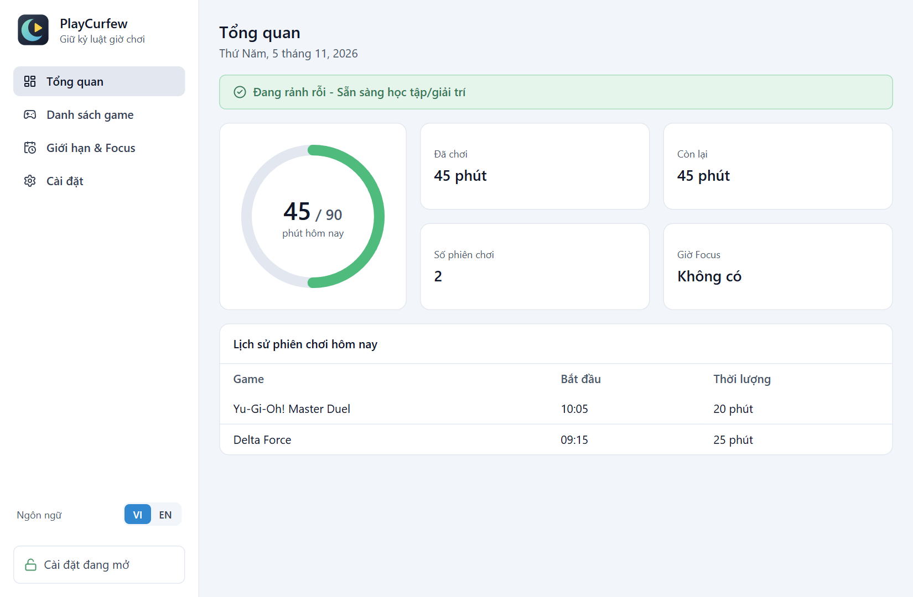 | 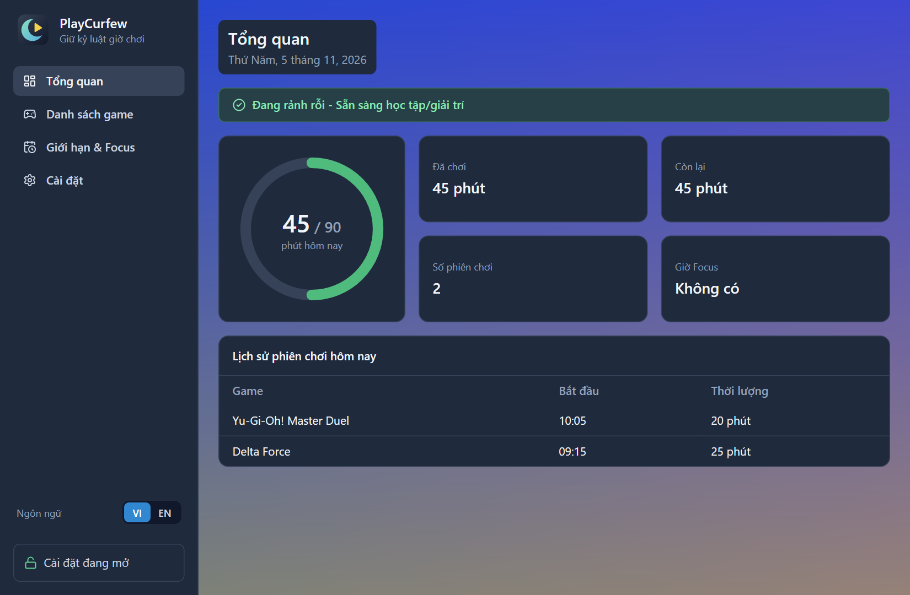 |

Các cài đặt này không bị khóa.

### Cơ chế khóa

Cài đặt tự khóa khi có một trong ba điều kiện: đang trong giờ Focus, đã hết giờ chơi hôm nay, hoặc đang có game được theo dõi chạy. Các thao tác bị khóa hiện biểu tượng ổ khóa.

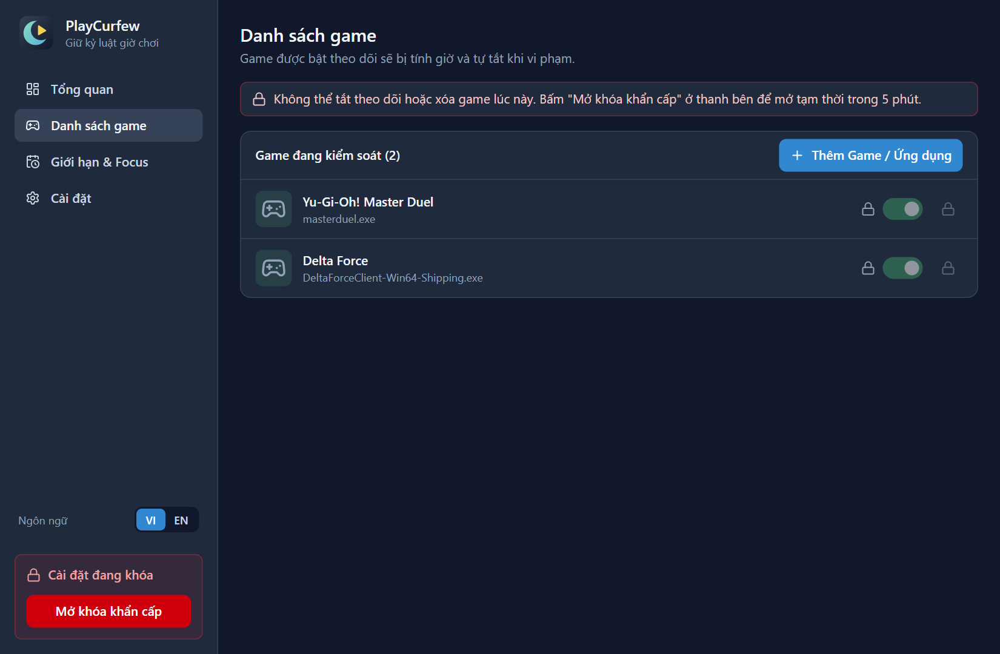

| Thao tác | Khi đang khóa |
| --- | --- |
| Thêm game, bật theo dõi | Được phép |
| Tắt theo dõi, xóa game | Bị khóa |
| Giảm giới hạn phút | Được phép |
| Tăng giới hạn phút | Bị khóa |
| Thêm khung giờ Focus, thêm ngày, bật khung giờ | Được phép |
| Tắt, xóa khung giờ Focus, bớt ngày | Bị khóa |
| Bật, tắt khởi động cùng Windows | Bị khóa |
| Thoát ứng dụng từ khay hệ thống | Bị khóa |

### Mở khóa khẩn cấp

1. Bấm **Mở khóa khẩn cấp** ở thanh bên. Nút này chỉ hiện khi đang khóa.
2. Gõ lại chính xác câu cam kết, gồm cả dấu câu và chữ hoa, chữ thường. Không thể dán văn bản. Ký tự đúng hiện màu xanh, ký tự sai hiện nền đỏ.
3. Khi câu khớp hoàn toàn, nút **Xác nhận Mở khóa (5 phút)** sáng lên. Bấm nút này.

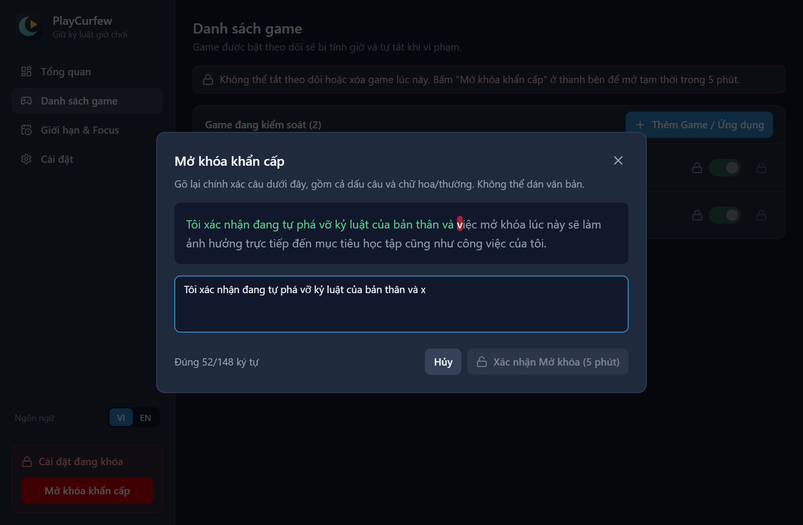

Thanh bên sẽ hiện đồng hồ đếm ngược. Hết 5 phút, cài đặt tự khóa lại. Mở khóa chỉ cho phép sửa cài đặt và thoát ứng dụng: game vẫn bị tắt nếu đang trong giờ Focus hoặc đã hết giờ.

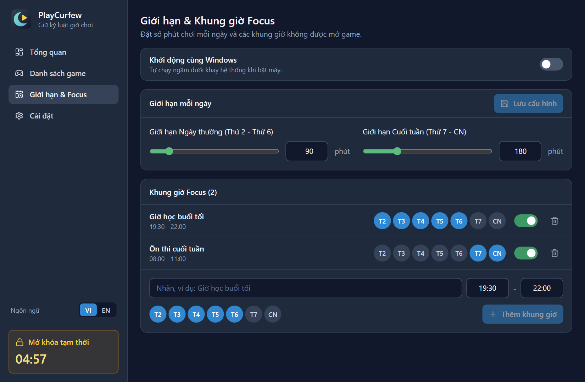

## Dữ liệu

Toàn bộ dữ liệu lưu trên máy tại `%APPDATA%\playcurfew\config.json`, không gửi đi đâu. Số giờ chơi tự đặt lại khi sang ngày mới.

## Hạn chế hiện tại

- **Vẫn có thể tắt bằng Task Manager.** Khóa nút Thoát chỉ chặn thoát từ ứng dụng. Tắt tiến trình bằng Task Manager thì việc theo dõi sẽ dừng.
- **Sửa cấu hình không bị chặn.** Sửa trực tiếp `config.json` vẫn thay đổi được cài đặt. PlayCurfew là công cụ hỗ trợ kỷ luật, không phải biện pháp chống phá.
- **Gỡ cài đặt:** tác vụ `PlayCurfewAutoStart` không tự bị xóa. Hãy tắt **Khởi động cùng Windows** trước khi gỡ.

## Dành cho nhà phát triển

| Lệnh | Tác dụng |
| --- | --- |
| `npm run dev` | Chạy ứng dụng với HMR |
| `npm run typecheck` | Kiểm tra TypeScript |
| `npm run lint` | Chạy ESLint |
| `npm run icons` | Tạo lại bộ icon từ `src/renderer/src/assets/logo.svg` |
| `npm run build` | Typecheck rồi bundle vào `out/` |
| `npm run build:unpack` | Đóng gói không cài đặt vào `dist/win-unpacked/` |
| `npm run build:win` | Tạo bộ cài Windows |

Mã nguồn gồm ba tầng trong `src/`, cùng phần kiểu dữ liệu dùng chung:

| Thư mục | Vai trò |
| --- | --- |
| `src/main/` | Quét tiến trình, đếm giờ, tắt game, lưu dữ liệu, xử lý IPC |
| `src/preload/` | Cầu nối `window.api` giữa main và renderer |
| `src/renderer/` | Giao diện React, Tailwind CSS |
| `src/shared/` | Kiểu dữ liệu dùng chung |

Đặc tả dữ liệu nằm trong [SPEC.md](SPEC.md), quy ước phát triển nằm trong [CLAUDE.md](CLAUDE.md).
